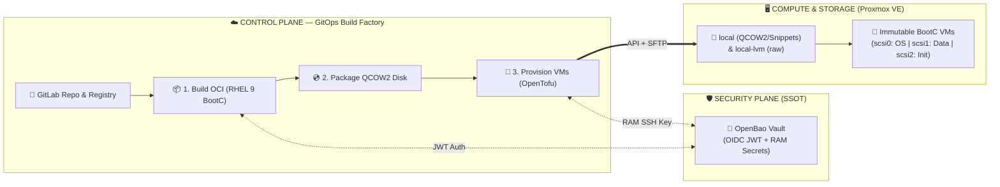

# 🛡️ Sovereign RHEL 9 BootC & OpenTofu Proxmox Pipeline

[](https://redhat.com)
[](https://openbao.org)
[](https://opentofu.org)
[](https://proxmox.com)
[](https://gitlab.com)

End-to-end **DevSecOps & GitOps Infrastructure-as-Code** factory that compiles an **immutable RHEL 9 Image Mode (`bootc`)** container, translates it into a bootable **QCOW2** virtual disk, and provisions sovereign appliances (such as **Zabbix 7.0 LTS**) onto **Proxmox VE** using **OpenTofu** and **Cloud-Init** - with **zero hardcoded secrets** and **zero disk writes** for credentials.

---

## 🏗️ Architecture & Workflow



### Key Engineering Highlights

* 🔒 **Zero-Trust Secret Management:** GitLab runners authenticate dynamically via short-lived OIDC JWT tokens. Registry tokens and SSH private keys are injected strictly into volatile memory (`/dev/shm` and `ssh-agent` sockets) and purged immediately.
* 🧱 **Immutable Operating System (`bootc`):** OS packages, hardened SELinux policies (`zabbix_can_network`, `krb5_keytab_t`), and Proxmox agents (`cloud-init`, `qemu-guest-agent`) are compiled into an OCI image for atomic upgrades (`bootc upgrade --apply`).
* ⚡ **Zero-Touch Day-0 Initialization:** Attached via `scsi2` (UEFI OVMF compatible), Cloud-Init partitions the secondary data disk (`scsi1` → `/var/lib/pgsql`), initializes PostgreSQL, and configures the firewall and web services automatically.
* 📐 **Declarative Topology:** Virtual machine sizing, bridge attachments, and static IP allocations are decoupled into `terraform/terraform.tfvars` with state locking managed by GitLab HTTP Backend.

---

## 📂 Repository Structure

```text
.
├── .gitattributes                 # Enforces Linux LF line endings across all scripts/templates
├── .gitlab-ci.yml                 # 3-stage pipeline (Build OCI → QCOW2 → OpenTofu Apply)
├── containers/
│   └── zabbix.Containerfile       # Immutable RHEL 9 BootC recipe + custom SELinux module
├── templates/
│   └── zabbix.yaml.tmpl           # Cloud-Init Day-0 bootstrapper (Disks, PostgreSQL, Nginx)
└── terraform/
    ├── main.tf                    # Proxmox VM, Cloud-Init snippet & LVM-Thin provisioning
    ├── providers.tf               # bpg/proxmox provider & GitLab HTTP remote state
    ├── variables.tf               # Typed input definitions & secret bindings
    ├── terraform.tfvars           # Declarative appliance matrix (CPU, RAM, Disks, IP)
    └── outputs.tf                 # Deployed VM IDs and network metadata
```

---


## 🚀 Deployment Lifecycle

1. **Customize:** Update `containers/zabbix.Containerfile` for OS/package changes or `terraform/terraform.tfvars` for VM sizing and IP allocation.
2. **Deploy:** Push to `main` to trigger the automated build, disk translation, and Proxmox provisioning.
3. **Day-2 Atomic Upgrades:** Run `sudo bootc upgrade --apply` on the appliance to pull newly built OCI layers while preserving persistent data on `/var/lib/pgsql`.